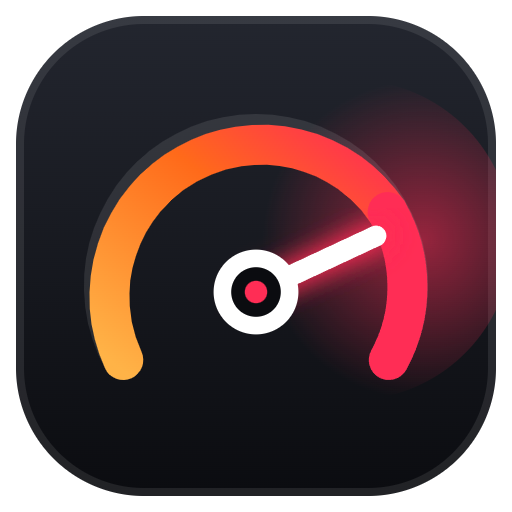
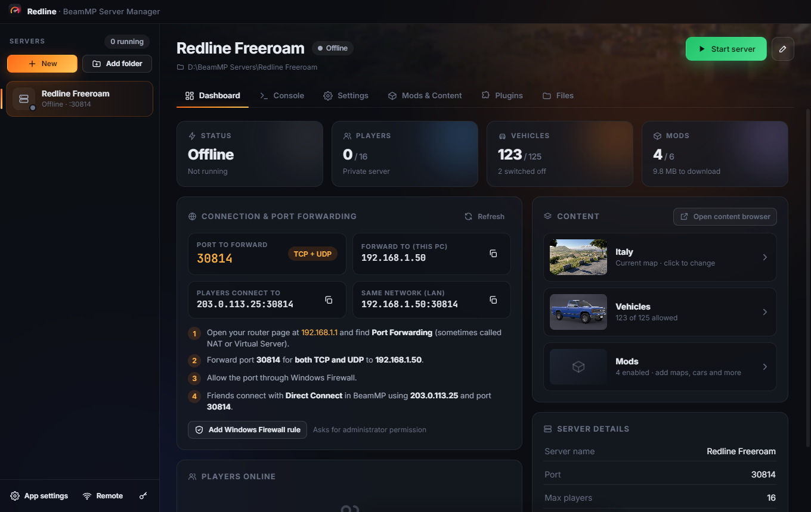
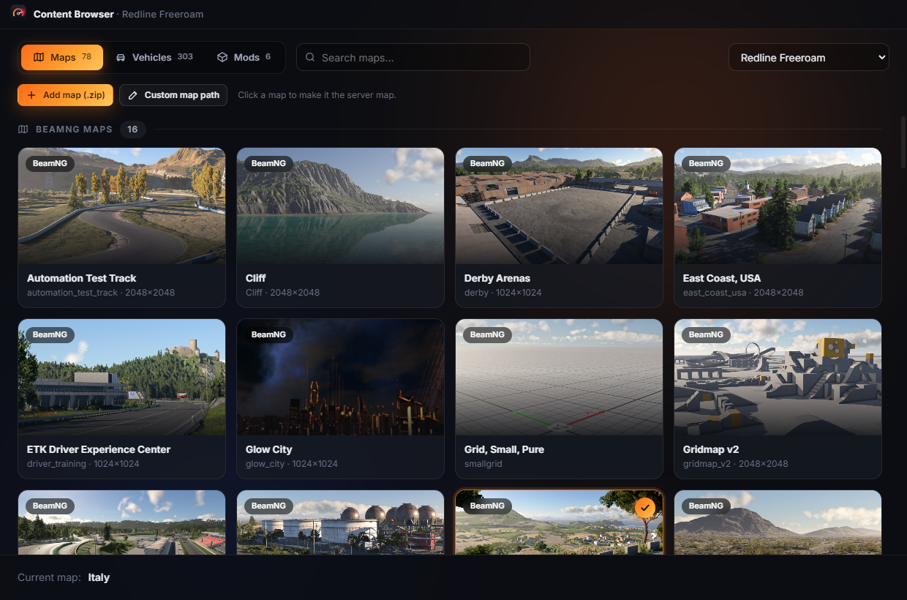
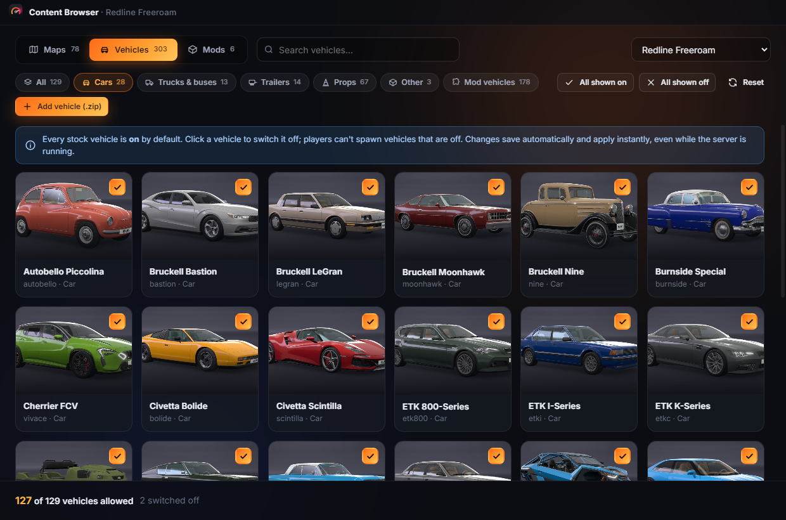
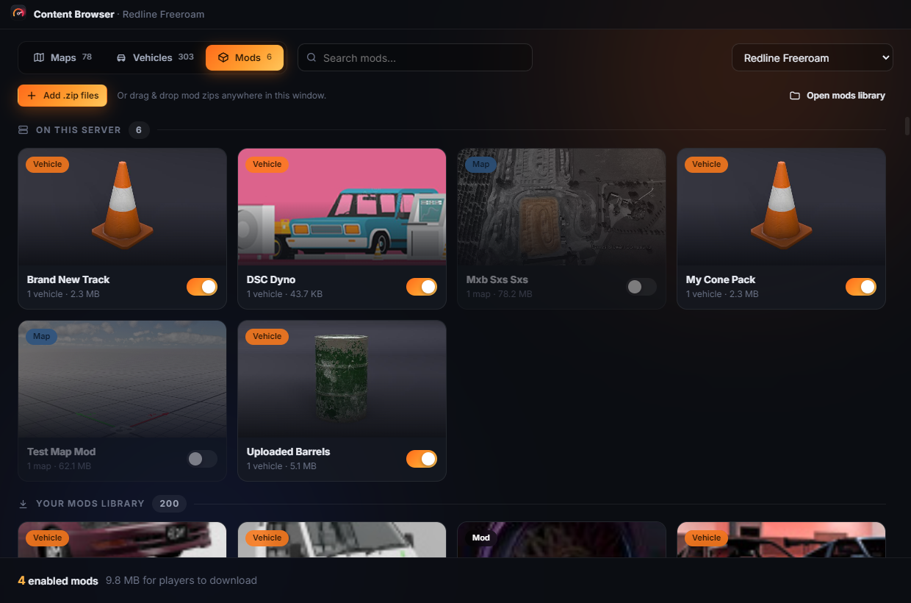
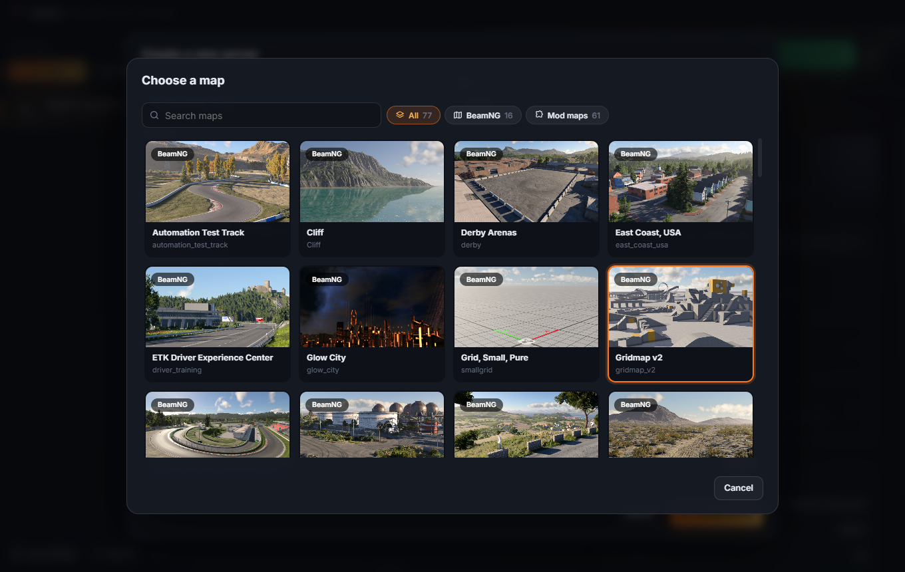
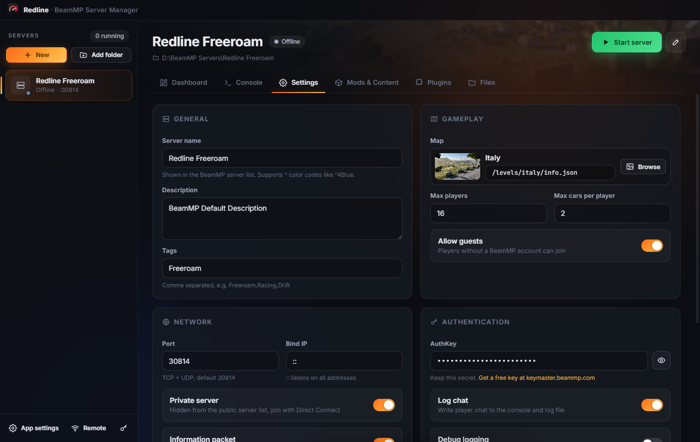
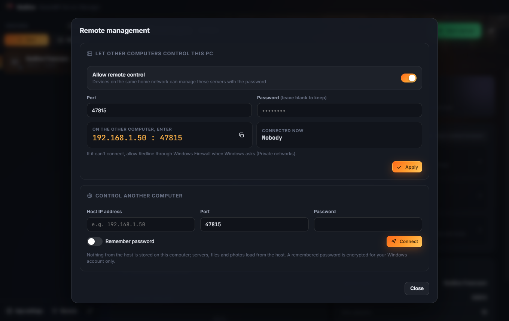

<p align="center"></p>

# Redline: BeamMP Server Manager

A desktop app for creating, configuring and running BeamMP servers.

**[⬇ Download the latest release](https://github.com/rare621/Redline-Beam-MP-Server-Manager/releases/latest)**



## Screenshots

| Maps with photos | Vehicles: switch any off |
| --- | --- |
|  |  |
| **Mods on the server and in your library** | **Choose a map when creating a server** |
|  |  |
| **Server settings** | **Remote management** |
|  |  |

## Download
Get the latest version from the [Releases page](https://github.com/rare621/Redline-Beam-MP-Server-Manager/releases/latest):
- **Redline-Setup-x.y.z.exe**: installer (Desktop + Start Menu shortcuts). Run it again to update; settings and servers are kept.
- **Redline-Portable-x.y.z.exe**: single exe, no install.

Windows may show "Windows protected your PC" because the app isn't code-signed: click **More info → Run anyway**.

Redline checks this page for new versions when it starts and every hour. When one is out, it offers to
download and install it for you (the portable exe opens the download page instead).

## Run from source
```bash
npm install
npm start
```
Build the installers with `npm run dist` (output in `dist/`).

## What it does
- **Create servers** in the app: downloads the latest official `BeamMP-Server.exe` from GitHub and writes `ServerConfig.toml`.
- **Add existing server folders** and manage several servers from the sidebar.
- **BeamMP Server updates**: when a new official version is out, the dashboard shows an **Update / Ignore** banner,
  and each server's Settings tab has an **Update server** button. Updating a running server stops it, installs the
  new version and starts it again.
- **Start / Stop / Restart** with a live console, command box (`say`, `kick`, `status`…), and crash detection.
- **Dashboard**: status, uptime, players online (with kick), and the IP/port to port-forward (TCP + UDP), your router address, and a one-click Windows Firewall rule.
- **Content Browser** (separate window):
  - **Maps**: every map in your BeamNG.drive install plus mod maps, with photos. Click to set the server map. Add or remove map mods.
  - **Vehicles**: every stock vehicle is **on by default**. Click to switch any vehicle off. Add or remove vehicle mods.
  - **Mods**: enable/disable/remove mods on the server, and add mods straight from your own BeamNG mods folder.
- **Settings** editor for every ServerConfig option (keeps the file's comments), plus a raw editor.
- **Plugins** (Resources/Server) and a **file browser** for the whole server folder. Drag and drop works everywhere.
- **Your BeamNG mods folder** is shown inside Maps and Vehicles: one click adds a mod map or vehicle to the server.
  The New Server dialog has a full map browser (BeamNG maps + your mod maps, with search and filters).
- **Only the map in use is downloaded**: when you change maps, unused map-only mods are switched off
  automatically (moved out of `Resources/Client`) and switched back on when selected again.
- **BeamMP mods**: the BeamMP Launcher's `Resources` folder (`%APPDATA%\BeamMP Launcher\Resources`, created if
  missing) is the central mods library. It shows as its own **BeamMP mods** category in Maps, Vehicles, Mods and the
  New Server map browser, next to your **BeamNG mods** folder (if BeamNG is installed). On a PC without BeamNG, every
  mod and track from your servers is collected there automatically. Changing the folder in App settings moves
  everything over.
- **Auto-detect** (App settings) finds BeamNG via Steam libraries, BeamNG's own settings file and common folders.
- **Remote management** (sidebar → Remote):
  - On the host PC: turn on "Allow remote control", set a password, note the `IP : port` shown.
  - On the other PC: enter that IP, port and password under "Control another computer" and click Connect.
  - Everything (servers, console, photos, mods) loads from the host; nothing is stored on the remote PC.
    Files you add from the remote PC are uploaded to the host.
  - While connected, a **This PC** section (Maps, Vehicles, Mods and the New Server map browser) lists the remote
    computer's own BeamNG mods and tracks; **Upload** sends them to the host with a progress bar.
  - Stock vehicles and maps show the real names and photos from **this PC's** BeamNG install, even if the host
    doesn't have BeamNG (nothing is copied to the host).
  - Recent connections are saved; "Remember password" stores it encrypted for your Windows account.
    The remote PC keeps no copies of the host's files or photos.
  - Same home network only. The password is never sent over the network, and repeated wrong guesses are locked out.
    Allow Redline through Windows Firewall on the host (Private networks) when Windows asks.

## Notes
- BeamMP requires an **AuthKey** from https://keymaster.beammp.com to start.
- Vehicle on/off and the player list use a small helper plugin the app installs into
  `Resources/Server/BeamMPManager` each time a server starts.
- Disabled mods are moved to `<server>/.manager/disabled_mods` so BeamMP doesn't load them.
- **Removing a mod** deletes it from the server for good, but your copy is always kept: in the central mods library or your BeamNG mods folder (if it was only on the server, it is saved to the library first). Deleting plugins, files or servers sends them to the Recycle Bin.
- Photos are read from your BeamNG.drive install and cached in `%APPDATA%/Redline/thumbs`.
